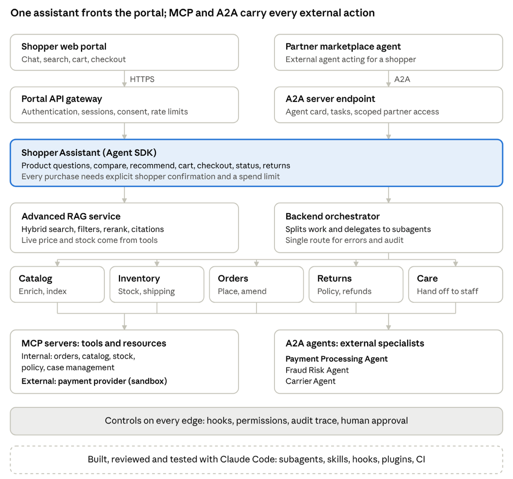
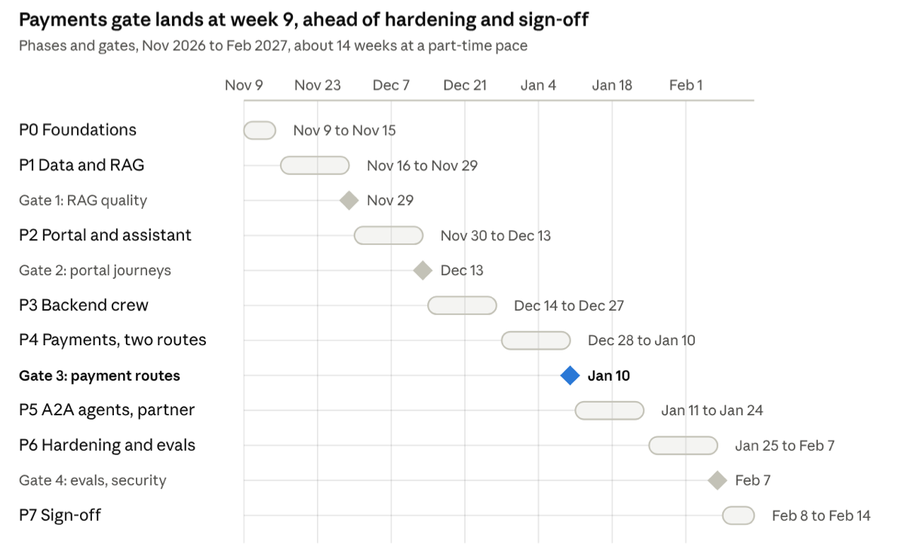

# Claude Code Advanced Features Lab — Retail PRD

Nov 2, 2026 · Vijaya Kumar Appasani

> Converted from `docs/PRD.pdf` (40 pages). Text, tables and requirement IDs are kept as written; page headers and footers are removed. The two figures are embedded as images rendered from the PDF, each with a text transcription.

## 1. Executive summary

This lab builds the **Northwind Shop**, an agent-driven retail portal for a fictional omnichannel retailer, **Northwind Outfitters**. Shoppers talk to an agentic assistant that answers product questions from an advanced RAG pipeline, builds a cart and completes the purchase; behind the portal a crew of backend agents runs catalog, inventory, orders, fulfilment, returns and payments. You build all of it with Claude Code so that you use every advanced capability on one realistic, measurable problem. Everything runs on synthetic data and sandbox services; nothing touches a real customer, card or carrier.

**The lab has two tracks.**

- **Track A, the product:**
  - A web portal with a **Shopper Assistant** (Claude Agent SDK) that handles product enquiries, recommendations, cart and checkout, order status and returns.
  - An **advanced RAG** layer that grounds product answers in the catalog, reviews, size guides and policies, while price and stock come live from tools, never from embeddings.
  - A **backend agent crew** coordinated by an orchestrator, with subagents for catalog, inventory and fulfilment, orders, returns and customer care.
  - **Payments by two interchangeable routes:** an external payment-provider **MCP server**, or a **Payment Processing Agent called over A2A**. Fraud-risk and carrier agents are also reached over A2A, and the Shopper Assistant is itself exposed as an A2A agent to a partner marketplace agent.
- **Track B, the engineering workflow:** you build Track A with Claude Code, using subagents, skills, hooks, slash commands, plugins, MCP servers, plan mode, memory, parallel worktrees, headless CI and the Agent SDK. Section 6 maps each feature to a requirement and a pass test, so the lab doubles as a feature-coverage checklist.

**Business case in one line:** a portal where an accountable agent system helps shoppers find the right product, buy it safely and get problems resolved can lift conversion, deflect support contacts and automate order exceptions, provided money movement, personal data and refunds stay under hard, auditable controls.

**Headline lab acceptance targets** (measured on synthetic evaluation sets, not production traffic; replace with your own baselines in section 10):

| Measure | Lab target | How it is checked |
|---|---|---|
| Product answers whose claims are supported by retrieved sources | 95% or more | LLM-judge plus human audit on 300 labelled queries |
| Retrieval recall@5 on labelled product questions | 90% or more | Retrieval evaluation harness |
| Assisted checkout journeys that complete in the sandbox | 95% or more | Scripted browser and API journeys |
| Unauthorized purchases or policy violations executed | 0 | Hook and gate tests plus adversarial cases |
| Card numbers appearing in model context, logs or traces | 0 | Automated scan of all captured traffic |
| Synthetic orders processed by backend agents with no human touch | 90% or more | Order replay |
| Claude Code features exercised with a passing test | 100% of the section 6 matrix | Coverage checklist signed off |

**Who this is for:** a technology leader who wants first-hand command of Claude Code and agentic patterns, with the security, privacy, compliance and value questions a CTO must answer before any of it reaches production.

## 2. Business problem and value case

Northwind sells apparel and home goods through its website and 40 stores. Its online journey loses shoppers at discovery, its back office handles orders and exceptions by hand across disconnected systems, and its post-purchase service is slow and leaky. The six pain points below are the origin of the requirements; each maps to a capability and a measure.

| Pain point | Today at Northwind (fictional) | What the agent system changes | Measure |
|---|---|---|---|
| Discovery friction | Keyword search misses intent such as "a waterproof jacket for light spring hiking under $150 that fits a wide frame" | Shopper Assistant uses hybrid, filtered, reranked retrieval over catalog, reviews and size guides, and cites its sources | Search-to-cart rate, zero-result searches |
| Cart abandonment and unanswered questions | Shoppers leave to look for sizing, stock or delivery answers | Assistant answers in context, checks live stock and delivery promise, and offers to complete the purchase | Conversion on assisted sessions, average order value |
| Back-office order exceptions | Staff chase address errors, stock-outs and payment declines across three systems | Order, inventory and fulfilment agents resolve routine exceptions and escalate the rest with context | Touchless order rate, exception handling cost |
| Stale and thin product content | Catalog descriptions are inconsistent, so retrieval and search suffer | Catalog agent enriches attributes and re-indexes on change | Attribute completeness, retrieval recall |
| Returns, status contacts and refund leakage | Policy applied differently by each agent; serial abuse found late | Returns agent applies policy; fraud-risk agent scores requests; hooks cap refunds | Contacts per order, leakage as % of refunded value |
| Payment friction and risk | Redirects and re-entry lose buyers; agent-initiated payments have no standard control | Tokenized payment through an MCP server or A2A payment agent, with explicit shopper confirmation and spend limits | Checkout completion, payment disputes |

### Illustrative baselines (assumptions, not facts)

These numbers are assumptions I invented for the synthetic company so the value model has something to compute. Replace them with your own before drawing any conclusion.

| Assumption | Value |
|---|---|
| Website sessions per month | 5,000,000 |
| Conversion rate | 2.4% (120,000 orders per month) |
| Average order value, gross margin | $75, 35% |
| Share of sessions using the assistant | 10% (500,000) |
| Conversion uplift on assisted sessions | +0.3 percentage points |
| Post-purchase contacts per month, cost per human-handled contact | 36,000, $4.50 |
| Order exceptions needing staff, cost per exception | 8% of orders (9,600), $6 |
| Returns and average refund | 22% of orders (26,400), $62 |
| Refund leakage | 1.2% of refunded value |

### Worked value model

```math
V = S_a \Delta c \cdot AOV \cdot m + N_c \cdot d \cdot k_c + N_e \cdot t \cdot k_e + R \cdot \ell \cdot r - C_{platform}
```

Here Sₐ is assisted sessions, Δc the conversion uplift, m gross margin, Nᶜ contacts, d the share deflected, Nₑ exceptions, t the touchless share, k the cost per item, R refunded value, ℓ leakage, r the share the controls prevent, and C platform and token cost.

| Value lever | Calculation on the assumptions above | Monthly value |
|---|---|---|
| Extra margin from assisted conversion | 500,000 × 0.003 = 1,500 orders × $75 × 35% | $39,375 |
| Contacts deflected (70%) | 36,000 × 0.70 × $4.50 | $113,400 |
| Order exceptions made touchless (60%) | 9,600 × 0.60 × $6 | $34,560 |
| Refund leakage halved | 26,400 × $62 × 1.2% × 50% | about $9,820 |
| **Total before platform cost** | | **about $197,000** |

Platform and model cost is deliberately left open: measuring cost per conversation, per checkout and per resolved case is itself a lab objective (section 10).

### Why this problem fits the lab

- **Many systems, one journey:** catalog, stock, policy, payments, carriers and fraud force real MCP and A2A integration, not toy tools.
- **Hard rules and soft judgment:** purchase limits and identity checks need hooks; tone, recommendations and explanations need prompts, skills and few-shot examples.
- **Retrieval that must be right:** wrong size or material claims cost money, so RAG quality is measurable and unavoidable.
- **Real risk:** money movement and personal data make security, privacy and human-in-the-loop design central.

## 3. Users, personas and scope

Version 1 serves one shopper journey end to end (discover, decide, buy, track, return) plus the back-office agents behind it, and deliberately leaves out anything that needs real money, real people's data or more than one language.

### Personas

| Persona | Type | What they need from the system |
|---|---|---|
| Shopper | Human, external | Honest product answers, a trustworthy checkout, quick status and returns |
| Customer-care associate | Human, internal | A complete case summary when the assistant escalates, plus approve or override tools |
| Merchandiser | Human, internal | Catalog enrichment review, search and recommendation quality reports |
| Operations lead | Human, internal | Order, stock and fulfilment exceptions resolved or clearly queued |
| Risk analyst | Human, internal | Fraud and refund-policy decisions with evidence and an audit trail |
| Partner marketplace agent | Non-human, external | A stable A2A interface to ask about products and place orders on a shopper's behalf |
| Lab engineer (you) | Human, builder | A repeatable way to build, test and review with Claude Code |
| CTO sponsor and security reviewer | Human, governance | Evidence that controls, privacy and cost are understood before any scale-up |

### Scope for version 1

**In scope:**

- Shopper portal with the Shopper Assistant: product enquiry, comparison, recommendation, cart, checkout, order status, return request.
- Advanced RAG over catalog, reviews, size and care guides, policies and FAQs, with live price and stock from tools.
- Backend agent crew: catalog enrichment and indexing, inventory and fulfilment, order management, returns and refunds, customer-care escalation.
- Payments through a payment MCP server in sandbox mode and through a Payment Processing Agent over A2A, behind one internal payment interface.
- A2A agents for fraud risk and carrier tracking, and an A2A endpoint exposing the Shopper Assistant to a partner agent.
- Observability, evaluation harness, CI, and the Claude Code feature coverage in section 6.

**Out of scope:** real payment processing or real card data, real customer data, native mobile apps, languages other than English, loyalty and pricing optimization, store point-of-sale, production hosting.

### Assumptions and recommended defaults

These are my proposals for a first build; each is a decision for you to confirm or change.

| Area | Recommended default | Why |
|---|---|---|
| Language and runtime | Python 3.12 for agents and services, TypeScript for the portal | One language for agents and the A2A Python SDK, a mainstream web stack for the front end |
| Agent framework | Claude Agent SDK (Python) for runtime agents | Same agent loop, hooks, subagents and MCP support as Claude Code |
| A2A | The official Python SDK (`a2a-sdk`) | Maintained by the A2A project |
| Data store | PostgreSQL with pgvector and full-text search | One store for orders and vectors keeps the lab simple |
| Embeddings and reranker | A provider of your choice | Anthropic does not offer its own embedding model; confirm current provider guidance |
| Local environment | Docker Compose | Reproducible stack with mock PSP, carrier and fraud services |
| Source control and CI | GitHub, with Claude Code GitHub Actions | Exercises headless and CI features |
| Observability | OpenTelemetry traces plus structured logs | Needed for agent audit and cost measurement |

Other assumptions: you have Claude API access and a Claude Code installation on a machine where you may run containers; you can create a sandbox account with one payment provider; and all data, products and customers are generated.

## 4. Solution architecture

**One assistant fronts the portal; MCP and A2A carry every external action**



*Northwind Shop architecture · portal, assistant, RAG, agent crew, MCP and A2A edges*

<details>
<summary>Figure transcription</summary>

- **Shopper web portal** (chat, search, cart, checkout) → HTTPS → **Portal API gateway** (authentication, sessions, consent, rate limits) → Shopper Assistant.
- **Partner marketplace agent** (external agent acting for a shopper) → A2A → **A2A server endpoint** (agent card, tasks, scoped partner access) → Shopper Assistant.
- **Shopper Assistant (Agent SDK):** product questions, compare, recommend, cart, checkout, status, returns. Every purchase needs explicit shopper confirmation and a spend limit.
- The Shopper Assistant calls:
  - **Advanced RAG service:** hybrid search, filters, rerank, citations. Live price and stock come from tools.
  - **Backend orchestrator:** splits work and delegates to subagents. Single route for errors and audit.
- The orchestrator's subagents: **Catalog** (enrich, index), **Inventory** (stock, shipping), **Orders** (place, amend), **Returns** (policy, refunds), **Care** (hand off to staff).
- The subagents reach:
  - **MCP servers: tools and resources.** Internal: orders, catalog, stock, policy, case management. External: payment provider (sandbox).
  - **A2A agents: external specialists.** Payment Processing Agent, Fraud Risk Agent, Carrier Agent.
- Across all of it: **Controls on every edge:** hooks, permissions, audit trace, human approval.
- Around all of it: *Built, reviewed and tested with Claude Code: subagents, skills, hooks, plugins, CI.*

</details>

Shoppers (and partner agents) reach one Shopper Assistant. It retrieves grounded product context from the RAG service and hands transactional work to the backend orchestrator, whose subagents call internal MCP servers and external MCP and A2A services; payments can take either the external MCP route or the A2A Payment Processing Agent.

### Design principles

- **One front door per audience.** Humans arrive through the portal gateway and partner agents through the A2A endpoint; both reach the same assistant under the same controls.
- **Retrieval for knowledge, tools for facts.** Descriptions, reviews and guides are retrieved; price, stock, delivery dates and order state are always read live through MCP tools, so they are never stale or invented.
- **Subagents own domains.** Each backend subagent has its own context, tools and permissions, and only the orchestrator talks to all of them, which keeps errors, audit and information flow in one place.
- **Every external action crosses a governed edge.** Payments, fraud checks and carrier calls pass through MCP or A2A boundaries where hooks, scopes, tokens and approvals apply.
- **Cards never enter the model.** The portal collects payment details in the provider's hosted fields; agents only ever see tokens and payment intents.

## 5. Product requirements

The 52 requirements below are grouped into six epics. Priority uses MoSCoW (Must, Should, Could) for version 1, and every acceptance criterion is something a test or an evaluation run can pass or fail. Non-functional requirements (security, privacy, resilience, cost) are in section 8, and the Claude Code build requirements are in section 6.

### Epic 1: Shopper portal and assistant (SA)

| ID | Requirement | Priority | Acceptance criteria |
|---|---|---|---|
| SA-01 | Portal with home, search results, product detail, cart, checkout, order history and a chat panel | Must | Scripted browser journeys cover every page without error |
| SA-02 | Streaming chat with inline product cards and visible source citations | Must | Answer starts streaming within 2 seconds; every product claim shows a source link |
| SA-03 | Intent coverage: product question, comparison, recommendation, availability, delivery, order status, return, policy | Must | Each intent has at least 10 labelled test conversations and a pass rate reported |
| SA-04 | Ask a clarifying question when size, budget or use is ambiguous instead of guessing | Should | On 20 deliberately ambiguous prompts, the assistant asks before recommending in at least 90% |
| SA-05 | Conversation memory within a session; cross-session preferences only with opt-in consent | Should | Opted-out shoppers have no preference data stored; verified by a data check |
| SA-06 | Human handoff with a structured summary; an explicit request for a person is honored immediately | Must | Handoff payload contains identity, intent, root cause, amounts and recommended action |
| SA-07 | Portal meets WCAG 2.1 AA for the core journey | Should | Automated accessibility scan has no critical findings |
| SA-08 | Brand voice defined once and reused across assistant surfaces | Could | A voice skill or output style is applied and reviewed |

### Epic 2: Advanced RAG (RAG)

| ID | Requirement | Priority | Acceptance criteria |
|---|---|---|---|
| RAG-01 | Versioned ingestion of catalog, reviews, size and care guides, policies and FAQs, each chunk carrying metadata (category, brand, size, colour, material, price band, region, updated date) | Must | Re-ingest is idempotent; metadata present on 100% of chunks |
| RAG-02 | Contextual chunk enrichment: each chunk is prefixed with a short generated statement of where it sits in its product or document before embedding and indexing | Should | Recall@5 on the evaluation set improves over the plain-chunk baseline, and the delta is reported |
| RAG-03 | Hybrid retrieval combining dense vectors and keyword search, fused by rank | Must | Beats dense-only and keyword-only on recall@5 in the evaluation harness |
| RAG-04 | Query understanding: rewrite, split multi-part questions, and extract structured filters (price, size, colour, availability) | Must | Filter extraction is at least 95% correct on 100 labelled queries |
| RAG-05 | Rerank the top candidates before generation | Should | Reranking raises MRR over fused retrieval, reported |
| RAG-06 | Parent-child chunking so product-level and variant-level questions both retrieve the right level | Should | Variant questions ("does the blue one come in 4XL?") answer from variant data |
| RAG-07 | Intent router selects the index or indexes (specifications, reviews, policy) | Should | Routing accuracy at least 90% on labelled queries |
| RAG-08 | Grounded answers with citations; when evidence is insufficient the assistant says so or asks, and never invents attributes | Must | Groundedness at least 95% on 300 queries; zero fabricated-attribute cases in the adversarial set |
| RAG-09 | Price, stock, promotions and delivery dates come from live tools only; catalog changes reach the index within 10 minutes | Must | Test changes price and stock; the assistant never quotes a stale value |
| RAG-10 | Agentic retrieval: the assistant may re-query or refine filters when evidence is thin, within a fixed step budget | Should | No answer needs more than 3 retrieval rounds; step cap enforced by a test |
| RAG-11 | Retrieval is access-aware: internal-only documents are never returned to shoppers; regional policies match the shopper's region | Must | Red-team queries cannot surface internal content |
| RAG-12 | Evaluation harness with recall@k, MRR, groundedness and answer relevance, wired into CI as a regression gate | Must | A change that lowers any metric beyond a set tolerance fails the build |
| RAG-13 | Cost control: prompt caching on the stable prompt prefix and a report of tokens per answer | Should | Cache-hit rate and cost per answer appear in telemetry |

### Epic 3: Agentic shopping and checkout (CHK)

| ID | Requirement | Priority | Acceptance criteria |
|---|---|---|---|
| CHK-01 | Cart tools: add, remove, change quantity, with live stock check | Must | Out-of-stock add is refused with alternatives offered |
| CHK-02 | Order summary (items, total, delivery, return policy) must be confirmed by the shopper through a portal UI control, not by free-text in chat | Must | Order cannot be placed in any test without the confirmation event |
| CHK-03 | Per-session and per-day spend and velocity limits; above-limit requests need step-up authentication or a human | Must | Limit-breaking journeys are blocked and logged |
| CHK-04 | Delivery options and promise from the carrier agent at checkout | Should | Quote shown matches the carrier agent response |
| CHK-05 | Idempotent order placement: retries and duplicate messages never create a second order or charge | Must | Replaying the same request 10 times yields one order |
| CHK-06 | Order status and delivery tracking in chat | Must | Status matches the order store and carrier tracking in test data |
| CHK-07 | Return initiation with eligibility from the policy resource and an explanation of the outcome | Must | Eligible, ineligible and ambiguous returns each handled correctly on labelled cases |

### Epic 4: Payments (PAY)

| ID | Requirement | Priority | Acceptance criteria |
|---|---|---|---|
| PAY-01 | One internal payment port with authorize, capture, void, refund and status, using idempotency keys | Must | The same contract test suite passes against every adapter |
| PAY-02 | MCP route: adapter that calls a payment provider's sandbox MCP server with tokenized payment methods and scoped credentials | Must | Authorize, capture and refund succeed in the sandbox; credentials come from environment variables, never committed |
| PAY-03 | A2A route: adapter that delegates to the Payment Processing Agent as an A2A task and handles interrupted states (input required, auth required) by returning control to the shopper UI | Must | A step-up authentication case completes after the shopper acts and resumes the same task |
| PAY-04 | Route chosen by configuration with a per-order override; a comparison report covers latency, failure behaviour, auditability and cost of each route | Must | Both routes pass identical tests; the report exists and states a recommendation |
| PAY-05 | No card number or CVV in model context, prompts, tool arguments, logs or traces; the portal uses the provider's hosted fields | Must | A scanner over all captured traffic finds zero matches |
| PAY-06 | Refund control: a hook caps automated refunds at a configured amount and requires human approval above it | Must | A refund over the cap is blocked and redirected to approval in every test |
| PAY-07 | Asynchronous payment status through provider webhooks or A2A push notifications | Should | Delayed settlement updates the order without polling |
| PAY-08 | Failure handling for declines, timeouts, duplicates and partial captures, with compensating actions | Must | A fault-injection suite leaves no double charge and no orphaned order |

### Epic 5: Backend agent crew (BE)

| ID | Requirement | Priority | Acceptance criteria |
|---|---|---|---|
| BE-01 | Orchestrator decomposes order events and requests, delegates to subagents, runs independent work in parallel and aggregates results | Must | A multi-concern request is split, run in parallel and answered as one result |
| BE-02 | Structured errors between agents (failure type, attempted action, partial results, alternatives); subagents recover transient failures locally | Must | Injected timeouts produce partial results with annotations, not a crashed run or a silent empty success |
| BE-03 | Catalog agent enriches attributes from supplier feeds, queues changes for merchandiser review and triggers re-indexing | Should | Unreviewed changes never publish; approved changes reach the index within 10 minutes |
| BE-04 | Inventory and fulfilment agent reserves stock, proposes substitutes on stock-outs and selects a fulfilment node | Must | Race tests on the last unit never oversell |
| BE-05 | Order agent validates, requests a fraud score, takes payment through the payment port and confirms; it resolves routine exceptions (address typo, soft decline) and escalates the rest | Must | At least 90% of synthetic orders complete with no human touch; every escalation carries context |
| BE-06 | Returns agent checks eligibility, issues a label through the carrier agent, refunds through the payment port and flags defective goods for a supplier claim | Must | Labelled return cases match the policy outcome in at least 95% |
| BE-07 | Care agent builds an escalation case (summary, root cause, amounts, recommended action) and queues it for staff | Must | Staff can act on a case without the transcript |
| BE-08 | Every agent action writes an audit event (actor, action, inputs by reference, outcome, correlation ID) | Must | Any order can be reconstructed end to end from audit events alone |

### Epic 6: A2A agents and exposure (A2A)

| ID | Requirement | Priority | Acceptance criteria |
|---|---|---|---|
| A2A-01 | Each external specialist publishes an agent card (name, skills, interfaces, security scheme) and the system discovers it from configuration | Must | Cards validate against the protocol definition; discovery fails closed on a bad card |
| A2A-02 | Fraud Risk Agent (mock A2A server) returns a risk score with reasons as an artifact and asks for more input when evidence is missing | Must | Scored and input-required paths both exercised |
| A2A-03 | Carrier Agent (mock) provides quote, label and tracking, with streamed tracking updates | Should | A streamed update changes order status without polling |
| A2A-04 | Payment Processing Agent (mock) handles authorize, capture and refund as tasks through the full lifecycle, including auth-required | Must | Same behaviour as PAY-03 contract tests |
| A2A-05 | Expose the Shopper Assistant as an A2A server; a partner test agent can discover it, ask product questions and place a scoped order | Should | Partner journey passes; out-of-scope requests are rejected |
| A2A-06 | Authentication per agent card: OAuth 2.0 client credentials or mutual TLS between services, with scoped, short-lived tokens and no secrets in prompts | Must | Calls without a valid token are rejected; no credential appears in any prompt or trace |
| A2A-07 | Client handles every task state (submitted, working, completed, failed, canceled, rejected, input-required, auth-required), cancellation and timeouts | Must | A state-machine test covers each state and each transition used |
| A2A-08 | Push notifications for long-running tasks with verified callbacks | Could | Forged callbacks are ignored |

## 6. Claude Code feature coverage matrix

Thirty features are listed, each with a concrete place in the build and a pass test; the lab is complete when every row has evidence. The inventory comes from the Claude Code documentation read on 2 November 2026 (code.claude.com). Several long pages were summarized by the reading agent, so skill and subagent frontmatter field names should be confirmed with `/skills` and `/agents` in your installed version before you rely on them.

### A. Instruct and remember

| ID | Feature | How the lab uses it | Pass test |
|---|---|---|---|
| CC-01 | `CLAUDE.md` hierarchy, `@import`, `CLAUDE.local.md`, `/memory`, `/init`, `/context` | Project file with build and test commands, the architecture map from section 4, and coding and security conventions; per-service files for payments and RAG; shared standards imported | `/memory` lists the expected files; a clean clone behaves the same; a convention is followed without being prompted |
| CC-02 | Path-scoped rules in `.claude/rules/` with `paths:` | Rules for `services/payments/**` (no card data in logs), `**/test_*.py`, `infra/**` | The payments rule loads only when a matching file is edited |
| CC-03 | Auto memory | Let Claude save project learnings, then review and prune the index | A second session reuses a command learned in the first |
| CC-04 | Plan mode and `/plan` | Plan the payment port and the RAG pipeline before any code; compare with direct execution on a one-file fix | A reviewed plan exists for both epics before the first edit |
| CC-05 | Context control: `/compact`, `/context`, `/model`, `/effort`, `/usage` | Compact a long RAG session; pick a smaller model for routine edits; record cost per epic | A cost-and-context report per epic |
| CC-06 | Session management: `--resume`, `--continue`, `/fork`, `/branch` | Resume a named session after a break; fork to compare two chunking strategies | Both fork results are kept and compared |

### B. Extend: skills, plugins, MCP, output styles

| ID | Feature | How the lab uses it | Pass test |
|---|---|---|---|
| CC-07 | Custom skills (`SKILL.md`; `context: fork`, `allowed-tools`, `argument-hint`, `disable-model-invocation`) | Skills such as `/add-mcp-tool`, `/new-a2a-agent`, `/rag-eval` (forked so noisy output stays out of the main chat) and `/threat-model` | Each skill runs from the slash command and, where allowed, by model invocation; forked output stays out of the main context |
| CC-08 | Legacy commands in `.claude/commands/` | Migrate one command to a skill and confirm both forms behave the same | Same result from both |
| CC-09 | Consuming MCP servers: `claude mcp add`, `.mcp.json`, scopes, `${ENV}` expansion, `/mcp`, resources | Project-scoped servers for the database, GitHub and browser automation; one personal server at user scope | All servers available at once; no secret committed |
| CC-10 | Building MCP servers | Northwind orders, catalog and policy servers with tools and resources, structured errors and `isError` | Contract tests pass; policy catalog is exposed as a resource |
| CC-11 | External payment MCP server | Connect a payment provider's sandbox MCP server in Claude Code and in the runtime agent | PAY-02 acceptance passes |
| CC-12 | Plugins (`plugin.json`, marketplace, `/plugin`, `--plugin-dir`) | Package the lab's skills, subagents, hooks and MCP config as a `northwind-lab` plugin with a local marketplace | Installing it on a clean machine reproduces the toolkit |
| CC-13 | Output styles | A reviewer style for audits and a learning style for onboarding; switch with `/output-style` | Style change visibly alters review output |

### C. Delegate and parallelize

| ID | Feature | How the lab uses it | Pass test |
|---|---|---|---|
| CC-14 | Custom subagents in `.claude/agents/` (`tools`, `model`, `permissionMode`, `memory`, `skills`, `mcpServers`, `hooks`) | `rag-evaluator`, `a2a-contract-tester`, `test-writer`, a read-only `security-reviewer`, `catalog-data-generator` | The security reviewer cannot edit files; each agent uses an intentionally chosen model |
| CC-15 | Built-in Explore and Plan subagents | Explore for discovery, Plan for design | Main-context usage stays below a budget you set, compared with doing discovery inline |
| CC-16 | Chaining and parallel subagents | Implement, test, review pipeline; three independent services built in parallel | Three service builds complete concurrently with a combined review |
| CC-17 | Git worktrees (`--worktree`, `isolation: worktree`, `.worktreeinclude`) | One worktree per epic for parallel Claude sessions | Three branches advance at once with no file conflicts |
| CC-18 | Background agents (`--bg`, `claude agents`, `/bg`, `/tasks`) | Long evaluation runs and catalog generation in the background | You can attach to, read logs from and stop a background session |

### D. Automate and build the runtime

| ID | Feature | How the lab uses it | Pass test |
|---|---|---|---|
| CC-19 | Hooks, lifecycle events (the docs list 33, including `SessionStart`, `UserPromptSubmit`, `PreToolUse`, `PermissionRequest`, `PostToolUse`, `PostToolUseFailure`, `SubagentStart`, `SubagentStop`, `Stop`, `PreCompact`, `PostCompact`, `ConfigChange`, `WorktreeCreate`, `Elicitation`, `SessionEnd`) | `PreToolUse` blocks edits to `.env*` and secrets paths and forced pushes; `PostToolUse` formats and runs affected tests; `UserPromptSubmit` adds the ticket context; `Stop` runs the evaluation gate; `PreCompact` saves a state note; `SubagentStop` writes to the audit log; `ConfigChange` flags settings edits | At least eight different events demonstrably fire; every blocked action fails to execute |
| CC-20 | Hook handler types: `command`, `http`, `mcp_tool`, `prompt`, `agent` | A shell script for the secret guard, an http hook posting to the audit collector, a prompt or agent hook for a policy check | At least three handler types in use, each with a test |
| CC-21 | Headless and print mode (`-p`, `--output-format json`, `stream-json`, `--json-schema`, `--max-turns`, `--max-budget-usd`, `--bare`, `--allowedTools`) | Nightly catalog-quality audit and a PR summary script that emit schema-valid JSON under a turn and cost cap | Output validates against the schema; the budget cap stops a deliberately runaway run |
| CC-22 | GitHub Actions (`anthropics/claude-code-action@v1`, `@claude`, `/install-github-app`) | Automated PR review with explicit review criteria in `CLAUDE.md` and a separate review instance from the author | A seeded-defect PR receives the expected comments; the false-positive rate is recorded |
| CC-23 | Agent SDK (Python) | Build the Shopper Assistant and backend orchestrator with custom tools, in-process hooks, subagents, MCP servers, permissions and session resume | Epics 1, 3 and 5 acceptance pass; the same refund-cap rule behaves identically here and in Claude Code hooks |
| CC-24 | Scheduled tasks (`/loop`, cron tools; cloud `/schedule`) | Poll CI and an evaluation run while you work; nightly regression run in the cloud | A loop reports a failing check; the nightly run produces a report |

### E. Control, review and safety

| ID | Feature | How the lab uses it | Pass test |
|---|---|---|---|
| CC-25 | Settings and permissions (`permissions.allow`, `ask`, `deny`; modes `default`, `acceptEdits`, `plan`, `auto`; managed, local, project and user precedence) | Deny reading `.env`; allow `npm run *` and the lab's MCP tools; ask before pushes; demonstrate precedence with a local override; keep `bypassPermissions` for sandbox-only experiments | A denied action is refused in every mode you test; the precedence demo matches the documented order |
| CC-26 | Checkpointing and `/rewind` | Break a refactor on purpose and rewind code and conversation; note that changes made only by shell commands are not tracked | The restored state matches the checkpoint |
| CC-27 | Sandboxed Bash (`/sandbox`; network allow-list, filesystem rules) | Run agent builds with a domain allow-list limited to the package index, GitHub and the sandbox payment host | An attempt to reach an unlisted domain fails |
| CC-28 | Bundled review skills (`/security-review`, `/code-review`) | Run both on the payment port and A2A client; triage findings into issues | Findings triaged with a recorded accept or reject reason |
| CC-29 | IDE integration (VS Code or JetBrains) | Review a plan and a diff inline, then rewind from the editor | One full change reviewed in the IDE |

### F. Explore (documentation not reviewed for this draft)

| ID | Feature | How the lab uses it | Pass test |
|---|---|---|---|
| CC-30 | Agent teams, dynamic workflows (`/workflows`), goals (`/goal`), Chrome integration (`--chrome`), Remote Control and cloud sessions (`--teleport`), channels | Read each page, then try one on a real task, for example Chrome for portal journey checks and a workflow for the nightly evaluation | One page of findings per feature, with a keep or drop decision |

**Tracking:** keep the matrix as `COVERAGE.md` in the repository and have a skill update it from evidence (test output, screenshots, session names) so the checklist stays honest.

## 7. MCP and A2A design

Use MCP for deterministic tools you own and A2A for autonomous peers across a trust boundary; keep both behind interfaces your own code controls, so a route can be swapped without touching the assistant. This section specifies the servers, the agents and the rules that connect them.

### MCP server catalog

| Server | Type | Tools (examples) | Resources | Scope and auth |
|---|---|---|---|---|
| northwind-orders | Internal | `get_order`, `list_orders`, `create_order` (idempotency key required), `update_delivery_address`, `cancel_order` | Order schema | Per-user token; shoppers can read only their own orders |
| northwind-catalog | Internal | `search_products` (structured filters), `get_product`, `get_variant`, `check_stock`, `get_price` | Category tree, attribute dictionary | Read-only for the assistant |
| northwind-rag | Internal | `retrieve_context` (query, filters, k) returning passages with source IDs and scores | Index manifest (what is indexed, last refresh) | Read-only; internal-only documents excluded for shopper callers |
| northwind-policy | Internal | `evaluate_return_eligibility` | Returns, shipping and warranty policies | Read-only |
| northwind-cases | Internal | `create_case`, `add_note`, `assign_case` | Case templates | Care agent only |
| Payment provider MCP | External | Provider-defined payment-intent, capture and refund tools (confirm the real list) | Provider-defined | Sandbox keys in environment variables; reached only through the payment port |
| Build-time servers | External | Repository, database and browser-automation servers for Claude Code | Varies | Project scope in `.mcp.json`; read-only database credentials |

### Tool design rules

- **Descriptions carry the weight.** State what the tool does, when to use it, when not to, accepted input formats and one example. Near-duplicate descriptions (such as `get_order` vs `get_order_history`) are rejected in review.
- **Structured errors.** Every tool returns `isError` plus `errorCategory` (transient, validation, business, permission), `isRetryable` and a human-readable message, and separates "access failed" from "valid empty result".
- **Small tool sets per agent.** Give each agent only the tools it needs, as below, because very large tool lists degrade selection and widen the blast radius.
- **Resources for catalogs.** Expose policies, category trees and the index manifest as resources so agents do not make exploratory calls.
- **Idempotency and dry runs.** Any tool that changes state accepts an idempotency key and, where useful, a `dry_run` flag the tests use.

### Tool scoping by agent

| Agent | Allowed MCP tools | Explicitly not allowed |
|---|---|---|
| Shopper Assistant | `retrieve_context`, `search_products`, `get_product`, `get_variant`, `check_stock`, `get_price`, cart tools, `get_order` (own orders), `evaluate_return_eligibility` | Any refund, payment capture or case-assignment tool |
| Orders subagent | `create_order`, `update_delivery_address`, `cancel_order`, payment port, fraud agent | Catalog writes |
| Returns subagent | `get_order`, `evaluate_return_eligibility`, carrier agent, payment port refunds under the cap | Refunds above the cap (hook-blocked) |
| Catalog subagent | Catalog write tools, northwind-rag index refresh | Order and payment tools |
| Care subagent | `create_case`, `add_note`, `get_order` | Payment tools |

### A2A concepts the lab uses

These facts come from the protocol's definition file (`a2a.proto`) in the official [A2A](https://github.com/a2aproject/A2A) [GitHub repository](https://github.com/a2aproject/A2A); the specification website could not be reached from this session. Not yet confirmed: the current release number, the standard path for discovering an agent card, and the JSON-RPC method names. Confirm them against the spec before building the clients.

| Concept | What the definition says | Lab use |
|---|---|---|
| Agent card | Self-describing manifest: name, description, interfaces, provider, version, capabilities (streaming, push notifications), security schemes and requirements, skills | One card per mock agent and one for the Shopper Assistant; validated in CI |
| Interface and binding | Each interface has a URL and a binding of JSONRPC, GRPC or HTTP+JSON | Pick one binding for all mock agents in phase 1; test a second on one agent |
| Task | Core unit of work with id, context id, status, artifacts and history | One task per payment attempt, fraud assessment or shipment query |
| Message and parts | A message has a role (user or agent) and parts: text, raw bytes, URL or structured data | Structured data parts carry JSON for decisions; text parts carry explanations |
| Artifact | The output of a task, delivered as parts | Fraud score and reasons; carrier label; payment receipt |
| Context | A context id groups related tasks and messages | Map one shopper conversation or one order to one context |
| Operations | Send message, send streaming message, get and list tasks, cancel task, subscribe to a task, create, get, list and delete push-notification configs, get extended agent card | Streaming for tracking; push for settlement; cancel on timeout |
| Security | Card-declared schemes: API key, HTTP auth, OAuth 2.0, OpenID Connect, mutual TLS; PKCE recommended | OAuth 2.0 client credentials between services; mutual TLS for the payment agent |

### Task states and how Northwind reacts

| State | Kind | Northwind behaviour |
|---|---|---|
| Submitted, working | Active | Show progress; apply a timeout; allow cancel |
| Input required | Interrupted | Ask the shopper or the upstream agent for the missing item, then resume the same task |
| Auth required | Interrupted | Send the shopper to step-up authentication, then resume; never continue silently |
| Completed | Terminal | Read artifacts, update order state, write the audit event |
| Failed, rejected | Terminal | Classify (retry, alternate route, escalate); never mark the order paid |
| Canceled | Terminal | Release stock reservations; confirm no charge was captured |

### External A2A agents (all mocks in the lab)

| Agent | Skills | Pattern | States exercised | Auth |
|---|---|---|---|---|
| Payment Processing Agent | Authorize, capture, refund, query | Long-running task; push notification for settlement | Working, auth required, input required, completed, failed | Mutual TLS plus scoped token |
| Fraud Risk Agent | Assess order risk, assess return risk | Request and response with a structured artifact | Completed, input required (missing evidence), rejected (out of scope) | OAuth 2.0 client credentials |
| Carrier Agent | Quote, create label, track | Streaming updates on a subscribed task | Working, completed, failed | OAuth 2.0 client credentials |
| Shopper Assistant (Northwind as server) | Product questions, scoped order placement | Partner agent calls in; Northwind enforces limits | Completed, rejected (outside scope), auth required | OAuth 2.0 with scopes and a spend ceiling |

### When to use MCP and when A2A

| Question | Use MCP when | Use A2A when |
|---|---|---|
| What is on the other side? | A deterministic tool with a fixed schema | An autonomous peer that reasons and may take several steps |
| Who owns it? | Your team, same trust domain | Another team or company, separate trust boundary |
| Duration and state | Short, mostly stateless call | Long-running, stateful, may need input or authorization mid-way |
| Example here | Order lookup, catalog search, policy check | Fraud assessment, carrier negotiation, payment processing agent |

Payments deliberately appear on both sides so you can compare them (PAY-04); this guidance is my own framing, since the spec comparison page was not read.

### Checkout over the two payment routes

1. The shopper confirms the order summary in the portal UI (CHK-02). The portal tokenizes the card through the provider's hosted fields; the assistant receives only a payment-method token.
2. The Orders subagent calls the fraud agent over A2A for a risk artifact and stops on a rejected or high-risk result.
3. **Route A, MCP:** the payment adapter calls the provider's sandbox MCP server to create and capture a payment intent with an idempotency key. A decline returns a business error; a timeout is retried only if the key makes it safe.
4. **Route B, A2A:** the adapter sends a task to the Payment Processing Agent. If the task enters auth required, the shopper completes step-up in the portal and the same task resumes; push notification confirms settlement.
5. On success the Orders subagent writes the order, the audit event and the confirmation; on failure it releases stock and returns structured error context to the orchestrator.

### Trust boundaries and controls

| Boundary | Threat | Control |
|---|---|---|
| Shopper to assistant | Prompt injection, attempts to force purchases or refunds | Confirmation by portal control, spend limits, no payment or refund tools on the assistant, hooks on every state-changing call |
| Retrieved content to model | Hostile text inside reviews or documents | Treat retrieved text as data, sanitize and label sources, no tool access derived from retrieved content |
| Assistant to MCP servers | Over-broad access, stolen tokens | Per-user, short-lived tokens, read-only defaults, per-agent tool allow-lists |
| Northwind to external A2A agents | Spoofed agents, tampered cards, data leakage | Allow-listed card sources, signed or pinned cards where supported, send minimum data, mutual TLS where required |
| Partner agent to Northwind | Over-reaching requests, abuse | Scoped OAuth, order ceiling, rate limits, audit trail per partner |
| Build time (Claude Code) | Secrets exposure, destructive commands | Permission rules, sandbox, secret-guard hooks, no production credentials in the lab |

## 8. Non-functional requirements: security, privacy, risk and governance

The controls that matter most are the ones that hold when the model is wrong or attacked: deterministic limits on money and refunds, card data kept out of the model, least-privilege tools and a complete audit trail. Latency and cost figures are starting targets for the lab, not benchmarks.

| ID | Area | Requirement | Verification |
|---|---|---|---|
| NFR-01 | Security | Least privilege: each agent and tool has an explicit allow-list; no agent holds a credential it does not use | Allow-list review plus a test that denied tools cannot be called |
| NFR-02 | Security | Secrets live in environment variables or a secrets manager, never in the repository, prompts or traces | Secret scanning in CI and a hook that blocks edits to secret files |
| NFR-03 | Security | Prompt-injection defences: retrieved and tool-returned text is labelled as data; high-impact tools are unavailable while untrusted content is being processed; an adversarial corpus is part of CI | Zero successful policy bypasses on the adversarial set |
| NFR-04 | Security | Card data stays out of Northwind systems through hosted fields and tokenization, which is the design aim for keeping PCI DSS scope small; confirm real scope with a qualified assessor before any production use | Traffic and log scan (PAY-05) |
| NFR-05 | Privacy | Data minimization: personal data is masked or omitted before model calls unless the task needs it | Test conversations show masked fields in captured prompts |
| NFR-06 | Privacy | Cross-session preferences only with consent; retention limits on conversation logs; the system can export and delete one shopper's data | Export and deletion tests on synthetic shoppers |
| NFR-07 | Privacy | Document where each data class is processed and stored, including which services receive it (model provider, search, payment) | Data-flow table kept current in the repository |
| NFR-08 | Compliance | The assistant discloses that it is an AI and tells shoppers when a human takes over | Visible in every journey test |
| NFR-09 | Governance | Risk-tier every tool: read-only, reversible write, irreversible or monetary. Monetary tools always need a deterministic limit and a confirmation or approval | Tool register with tier, limit and approver |
| NFR-10 | Governance | Append-only audit log with correlation IDs across assistant, subagents, MCP and A2A calls | Order reconstruction test (BE-08) |
| NFR-11 | Governance | Prompts, skills, agent cards and policies are versioned; changes pass the evaluation gate; rollback is one step | A failing evaluation blocks merge; rollback drill succeeds |
| NFR-12 | Governance | Kill switches by agent, by tool and by payment route | Flag flip stops the target within one minute in a drill |
| NFR-13 | Performance | First streamed token within 2 seconds at p95; retrieval within 600 ms at p95; checkout API within 5 seconds at p95 excluding shopper step-up | Load test report |
| NFR-14 | Resilience | Graceful degradation: if RAG is down the assistant says so and offers search; if one payment route fails the other can be selected by configuration; all outbound calls have timeouts and bounded retries | Fault-injection suite |
| NFR-15 | Observability | OpenTelemetry traces across every agent hop, with token and cost attribution per conversation and per checkout | Dashboard shows cost per resolved question and per order |
| NFR-16 | Cost | Per-conversation token budget; smaller model for routine steps; prompt caching on stable prefixes | Budget breach test; cache-hit report |
| NFR-17 | Quality | Evaluation sets are labelled, versioned and reviewed; metrics are tracked by segment, not only in aggregate | Segment report (category, intent, document type) |

### Frameworks to consult (informative, not legal advice)

Treat this table as a reading list for your compliance team. Confirm applicability with counsel before production.

| Concern | Frameworks and references worth mapping |
|---|---|
| AI risk management | NIST AI Risk Management Framework; ISO/IEC 42001 (AI management system) |
| LLM application security | OWASP Top 10 for LLM Applications |
| Payments | PCI DSS (scope depends on how card data flows) |
| Personal data | GDPR and Singapore's PDPA, depending on where shoppers are |
| Regional AI guidance | Singapore's Model AI Governance Framework; verify which apply to your market |

## 9. Delivery plan

**Payments gate lands at week 9, ahead of hardening and sign-off**
Phases and gates, Nov 2026 to Feb 2027, about 14 weeks at a part-time pace



*Delivery plan · 8 phases, 4 gates, Nov 2026 to Feb 2027*

<details>
<summary>Figure transcription</summary>

| Phase or gate | Dates |
|---|---|
| P0 Foundations | Nov 9 to Nov 15 |
| P1 Data and RAG | Nov 16 to Nov 29 |
| Gate 1: RAG quality | Nov 29 |
| P2 Portal and assistant | Nov 30 to Dec 13 |
| Gate 2: portal journeys | Dec 13 |
| P3 Backend crew | Dec 14 to Dec 27 |
| P4 Payments, two routes | Dec 28 to Jan 10 |
| **Gate 3: payment routes** (highlighted) | Jan 10 |
| P5 A2A agents, partner | Jan 11 to Jan 24 |
| P6 Hardening and evals | Jan 25 to Feb 7 |
| Gate 4: evals, security | Feb 7 |
| P7 Sign-off | Feb 8 to Feb 14 |

</details>

Eight phases run in sequence, with four gates that each need evidence before the next phase starts. Because you can run epics in separate worktrees (CC-17), the sequence compresses if you work full-time or in parallel sessions. Dates are a proposal starting Monday 9 November 2026; move them as you see fit.

| Phase | Focus | Main deliverables | Gate to pass |
|---|---|---|---|
| P0 Foundations | Repository, CLAUDE.md, settings, hooks, sandbox, plugin skeleton, synthetic data | Walking skeleton builds and tests in CI; CC-01 to CC-06, CC-25, CC-27 evidenced | None |
| P1 Data and RAG | Catalog, reviews and guides generated; ingestion, hybrid retrieval, evaluation harness; catalog and RAG MCP servers | RAG-01 to RAG-08 and RAG-12; CC-07, CC-09, CC-10 | Gate 1: recall@5 and groundedness meet targets |
| P2 Portal and assistant | Portal pages, streaming chat, assistant on the Agent SDK, cart tools, handoff | SA-01 to SA-06, CHK-01, CHK-06, CHK-07; CC-23 | Gate 2: scripted browser journeys pass |
| P3 Backend crew | Orchestrator and subagents, audit trail, order, inventory, returns and care agents | BE-01 to BE-08, CHK-05; CC-14 to CC-18 | None |
| P4 Payments, two routes | Payment port, MCP route, mock Payment Processing Agent and A2A route, fault injection | PAY-01 to PAY-08, A2A-04, A2A-07, CHK-02, CHK-03; CC-11, CC-19, CC-20 | Gate 3: both routes pass identical contract tests; no card data found in any trace |
| P5 A2A agents and partner | Fraud and carrier agents, streaming and push, assistant exposed as an A2A server, partner test agent | A2A-01 to A2A-03, A2A-05, A2A-06, A2A-08, CHK-04, RAG-09 to RAG-11 | None |
| P6 Hardening and evals | Adversarial suite, load and fault tests, cost report, security and code reviews, CI review bot | NFR-01 to NFR-17; CC-21, CC-22, CC-24, CC-28 | Gate 4: evaluation gate and security review pass |
| P7 Sign-off | Coverage matrix, payment-route comparison, retrospective, next-step recommendation | `COVERAGE.md` complete; CC-29, CC-30 | Every matrix row has evidence |

### Repository layout

```
northwind-shop/
  CLAUDE.md               project memory and conventions
  COVERAGE.md             evidence for the section 6 matrix
  .mcp.json               shared MCP servers (build time)
  .claude/
    settings.json         permissions, hooks, sandbox
    agents/               custom subagents
    skills/               /add-mcp-tool, /new-a2a-agent, /rag-eval, /threat-model
    rules/                path-scoped rules
    output-styles/        reviewer, learning
  apps/portal/            TypeScript web portal
  services/
    gateway/ assistant/ orchestrator/ rag/
    mcp-orders/ mcp-catalog/ mcp-policy/ mcp-cases/
    payment-port/
  agents-external/        mock A2A agents: payment, fraud, carrier
  partner-agent/          A2A test client
  data/                   synthetic catalog, shoppers, evaluation sets
  evals/                  retrieval, answers, journeys, adversarial
  infra/                  Docker Compose, OpenTelemetry
  .github/workflows/      CI and the Claude Code review action
```

### Environments

| Environment | Purpose | Data and services |
|---|---|---|
| Local | Daily development and Claude Code sessions | Docker Compose with synthetic data and mock agents; sandbox payment provider keys from environment variables |
| CI | Tests, evaluation gate, automated review | Ephemeral containers; secrets from the CI store; no production credentials exist anywhere |
| Sandbox integrations | Provider sandbox for the payment MCP route | Test cards and tokens only |
| Production | Not part of this lab | Out of scope |

## 10. Evaluation and success metrics

The lab succeeds when each target in section 1 is met on labelled, versioned evaluation sets, reported by segment rather than only in aggregate, and when every Claude Code feature row has evidence. Evaluation is itself a build deliverable: it runs in CI and blocks a change that makes any tracked metric worse beyond tolerance.

### Evaluation sets (proposed sizes)

| Set | Size | What it contains | Labels |
|---|---|---|---|
| Retrieval and answer set | 300 queries | Specification, comparison, intent-plus-filter, variant, policy, ambiguous and deliberately unanswerable questions | Human-labelled relevant passages and reference facts |
| Journey set | 40 scripted journeys | Search, ask, add to cart, confirm, pay (both routes), track, return | Pass or fail with expected order and payment state |
| Adversarial set | 120 cases | Instructions hidden in reviews, refund coercion, requests for other shoppers' data, price manipulation, partner over-reach, forged agent cards | Expected refusal or containment |
| Backend replay | 1,000 synthetic orders | About 10% with exceptions: address errors, stock-outs, soft declines, fraud flags | Expected outcome and escalation flag |
| Returns policy set | 150 cases | Eligible, ineligible and policy-gap returns | Policy decision and explanation |
| Payment fault matrix | Each failure mode on each route | Declines, timeouts, duplicates, partial captures, auth required | No double charge, no orphan order |

### Layers of testing

| Layer | What it proves | Gate |
|---|---|---|
| Contract and unit | MCP tool schemas and errors, payment port contract on both adapters, A2A state machine | Every pull request |
| Retrieval evaluation | Recall@k, MRR, filter accuracy, routing accuracy | Every change to ingestion, chunking, prompts or models |
| Answer evaluation | Groundedness and relevance, scored by a judge model calibrated against human labels, with sampled human audit | Every change to prompts, skills or models |
| Journey tests | End-to-end shopping in a browser against mocks | Merge to main |
| Adversarial and fault injection | Controls hold under attack and failure | Nightly, and before each gate |
| Load and cost | Latency targets and cost per conversation | Gate 4 |

Use a judge instance that is separate from the generating agent, check the judge against a human-labelled sample before trusting it, and sample high-scoring answers for audit, because aggregate scores can hide a failing category.

### KPIs to track

| Group | KPI |
|---|---|
| Product | Groundedness, recall@5, assisted checkout completion, touchless order rate, escalation correctness, policy violations executed |
| Risk and control | Card data in traces, blocked monetary actions, hook and gate coverage, adversarial pass rate |
| Economics | Cost per conversation, per checkout and per resolved case; cache-hit rate; model mix |
| Claude Code practice | Features evidenced of 30; share of generated changes accepted without edits; defects caught by the review bot versus escaped; cost and elapsed time per epic; parallel-worktree speed-up |

### Definition of done for the lab

- [ ] All Must requirements pass their acceptance criteria; Should items pass or have a written reason
- [ ] Gates 1 to 4 passed with evidence stored in the repository
- [ ] Both payment routes pass identical contract tests, and the comparison report recommends one with reasons
- [ ] Zero card data found in prompts, logs and traces on a full scan
- [ ] `COVERAGE.md` shows evidence for all 30 Claude Code rows
- [ ] Threat model, tool risk register and data-flow table written and reviewed
- [ ] Cost model replaces the assumptions in section 2 with measured figures
- [ ] Retrospective names what you would change before a pilot

## 11. Risks, open questions and sources

The biggest risks to the lab are scope, protocol and tooling churn, and quality claims that go untested; each has a named mitigation below.

### Risk register

| Risk | Impact | Mitigation |
|---|---|---|
| Scope is too large for one builder | Lab stalls before the payment gate | Phases and gates; cut Should and Could items first; run epics in parallel worktrees |
| A2A protocol or SDK changes (release number not confirmed here) | Rework of agents and cards | Pin SDK and spec versions; keep an adapter layer; confirm against the specification site once reachable |
| Fabricated product claims | Wrong purchases, returns, trust loss | RAG-08 grounding rule, live facts from tools, groundedness gate in CI |
| Prompt injection through reviews, documents or partner messages | Unauthorized actions or data exposure | NFR-03, no monetary tools on the assistant, hooks, adversarial suite |
| Duplicate or unauthorized purchase | Customer harm, disputes | CHK-02 portal confirmation, CHK-05 idempotency, spend limits |
| Card data reaches the model, logs or traces | Compliance breach | Hosted fields, PAY-05 scanner, secret and log hooks |
| Multi-agent token cost grows faster than value | Negative return | Budgets per conversation, caching, smaller models for routine steps, cost KPIs by epic |
| Over-permissive Claude Code settings during the build | Secret leak or destructive command | Deny rules, sandbox with network allow-list, secret-guard hooks, no real credentials, `bypassPermissions` only inside a throwaway sandbox |
| Mocks behave unlike real services | Overconfidence about integrations | Contract tests, and validate the payment route against the provider's real sandbox |
| Judge model bias or an overfitted evaluation set | Inflated quality claims | Held-out set, human audit sample, judge calibrated on labels |
| Claude Code features differ by version | Matrix rows cannot be completed | Record the version; confirm field names with `/skills`, `/agents`, `/hooks` and `/doctor` |

### Open questions

- [ ] Which payment provider's sandbox and MCP server will you use, and does it publish an MCP server you can reach?
- [ ] Which embedding model and vector or keyword store do you prefer, or should the lab default to PostgreSQL with `pgvector`?
- [ ] Python for the runtime agents (as proposed), or the TypeScript Agent SDK?
- [ ] Can `a2a-protocol.org` be allowed in the session network, so the spec's release number, card discovery path and method names can be confirmed?
- [ ] Should a later version evaluate agent-payment extensions or mandates layered on A2A? Not researched for this draft.
- [ ] Do you want a follow-up document with the full backlog, user stories and a first sprint plan?

### Sources

- **Claude Code documentation**, read on 2 November 2026 at code.claude.com (some long pages were summarized by the reading agent): [overview](https://code.claude.com/docs/en/overview), [sub-agents](https://code.claude.com/docs/en/sub-agents), [skills](https://code.claude.com/docs/en/skills), [hooks](https://code.claude.com/docs/en/hooks), [MCP](https://code.claude.com/docs/en/mcp), [memory](https://code.claude.com/docs/en/memory), [settings](https://code.claude.com/docs/en/settings), [permissions](https://code.claude.com/docs/en/permissions), [CLI reference](https://code.claude.com/docs/en/cli-reference), [headless](https://code.claude.com/docs/en/headless), [GitHub Actions](https://code.claude.com/docs/en/github-actions), [Agent SDK](https://code.claude.com/docs/en/agent-sdk/overview), [scheduled tasks](https://code.claude.com/docs/en/scheduled-tasks), [agent view](https://code.claude.com/docs/en/agent-view), [output styles](https://code.claude.com/docs/en/output-styles), [commands](https://code.claude.com/docs/en/commands), [checkpointing](https://code.claude.com/docs/en/checkpointing), [worktrees](https://code.claude.com/docs/en/worktrees), [sandboxing](https://code.claude.com/docs/en/sandboxing), [plugins](https://code.claude.com/docs/en/plugins/overview), [VS Code](https://code.claude.com/docs/en/vs-code), [JetBrains](https://code.claude.com/docs/en/jetbrains).
- **A2A protocol:** the [official repository](https://github.com/a2aproject/A2A), including `specification/a2a.proto`. The specification website was not reachable, so release number, discovery path and JSON-RPC method names are unconfirmed.
- **Illustrative data:** every business figure in sections 1 and 2 is an assumption invented for the fictional company, not a benchmark or a statistic.
